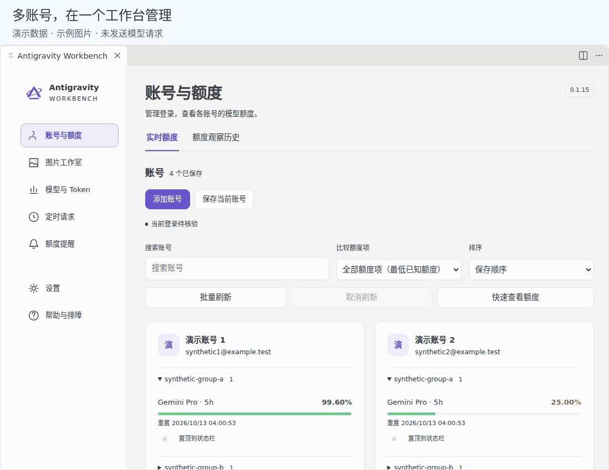

# Antigravity Workbench

**在 VS Code 中，把多个 Antigravity 账号、图片创作和 Token 用量放在一个工作台。**

少来回切换：比较各账号的模型额度，单独选择生图账号，从历史继续创作，查看本机的模型与 Token 记录。

**[从 VS Code Marketplace 安装](https://marketplace.visualstudio.com/items?itemName=xiaoxincodes.antigravity-account-manager)** · [快速开始](#快速开始) · [使用文档](docs/README.md) · [English](README_EN.md)

*实际 VS Code 界面，使用虚构账号、合成额度与用量、仓库示例图片；未发送模型请求。演示展示图片任务复用，不代表线上生图。*

## 三件事，一个工作台

### 多账号管理：先看额度，再决定用哪个

通过浏览器添加账号，或保存当前登录；在账号卡片中切换、刷新与管理账号。比较同一模型的剩余额度与重置时间，搜索、排序或收藏常用模型。需要换设备时，可用加密文件导入导出账号。

[账号管理与切换](docs/GETTING_STARTED.md#账号) · [加密迁移](docs/ACCOUNT_MIGRATION.md) · [额度操作](docs/QUOTA_WORKFLOWS.md)

### 图片工作室：从提示词到项目素材

跟随当前登录，或独立选择已保存账号生图。填写提示词、添加参考图，选择比例与尺寸；草稿和任务历史自动保留。复用参数、继续修改结果、比较版本，再把图片或 Markdown 放进项目。选择生图账号不会切换官方登录。

[图片入门与参数](docs/IMAGE_GENERATION.md) · [历史、继续创作与项目操作](docs/IMAGE_RESULTS.md)

### 模型与 Token 记录：看看用量花在哪里

只读查看本机记录，按时间、返回模型与项目筛选，查看每日趋势并导出 CSV / JSON。缺失用量保持“未提供”，不会算作零；查看与导出不发送模型请求。

[记录与用量说明](docs/REQUEST_MODEL_OBSERVATIONS.md)

**需要提醒或定时操作？** 可开启低额度、耗尽与恢复提醒；也可按日周、间隔或额度恢复安排普通模型请求。提醒和定时功能默认关闭，定时请求可能消耗额度，宿主需保持运行。[查看设置与执行规则](docs/QUOTA_WORKFLOWS.md)

## 快速开始

准备 **VS Code 1.95+** 和可用的 **Google Antigravity 扩展及登录**，让两个扩展运行在同一宿主。

1. 打开 [Marketplace](https://marketplace.visualstudio.com/items?itemName=xiaoxincodes.antigravity-account-manager) 点击 **Install**，或在 VS Code 扩展面板搜索 **Antigravity Workbench**。核对发布者 **XiaoXinCodes**、扩展 ID `xiaoxincodes.antigravity-account-manager`。
2. 按提示重载，在活动栏点击 **A**，打开工作台。英文界面可在“设置”中选择 **English**。
3. 在“账号与额度”查看已核验的当前身份；需要时点击“保存当前账号”或“添加账号”，再刷新额度。
4. 打开“图片工作室”选择账号与模型开始创作，或打开“模型与 Token 记录”查看本机用量。

切换账号前请保存工作，并核对确认框列出的后台与任务范围；切换可能中断范围内的活动任务。添加账号与切换账号是两个动作，完整流程见 [使用指南](docs/GETTING_STARTED.md)。

**WSL：** 核对 Google Antigravity 的实际运行位置；它在 WSL 时将 Workbench 也安装到同一发行版，它在本机时两者均保留在本机。[运行环境](docs/ENVIRONMENTS.md)

**离线安装：** 从 [最新 Release](https://github.com/XiaoXinCodes/antigravity-workbench/releases/latest) 下载 `.vsix`，在目标窗口执行 **Extensions: Install from VSIX…**。升级无需清空已有账号、登录文件、会话或图片。

## 兼容性与隐私

- 支持 Windows、macOS、Linux 本机扩展宿主及 WSL Linux 工作区宿主。SSH、容器及**独立 Antigravity IDE 尚未验证**。[兼容性与限制](docs/COMPATIBILITY.md)
- 可用模型、权限、输出与额度由所选账号的服务端结果决定；额度比例不等于可生成图片张数。本项目独立开发，与 Google 不存在隶属、授权或背书关系。
- 凭据使用 VS Code SecretStorage 或受限宿主存储；账号导出文件加密。草稿、参考图路径与任务记录留在当前宿主，图片保存到所选目录。生成时会将授权、提示词与参考图发送到对应 Google 服务；请仅提交有权使用的内容。[数据与安全说明](docs/PROJECT_NOTICES.md)

## 文档与反馈

[完整文档](docs/README.md) · [常见问题与排障](docs/TROUBLESHOOTING.md) · [更新日志](CHANGELOG.md) · [参与贡献](CONTRIBUTING.md)

遇到问题可在 [Issues](https://github.com/XiaoXinCodes/antigravity-workbench/issues) 提供版本、系统、运行宿主、复现步骤和错误码，请勿附凭据或私人内容；安全问题请按 [安全报告流程](SECURITY.md) 处理。

如果 Workbench 帮你少切了几次窗口，欢迎给仓库一个 **Star**，也方便下次找到它。

项目自有代码采用 [MIT License](LICENSE)，可使用、修改、分发及商用并保留许可声明；第三方材料见 [第三方声明](THIRD_PARTY_NOTICES.txt)。
