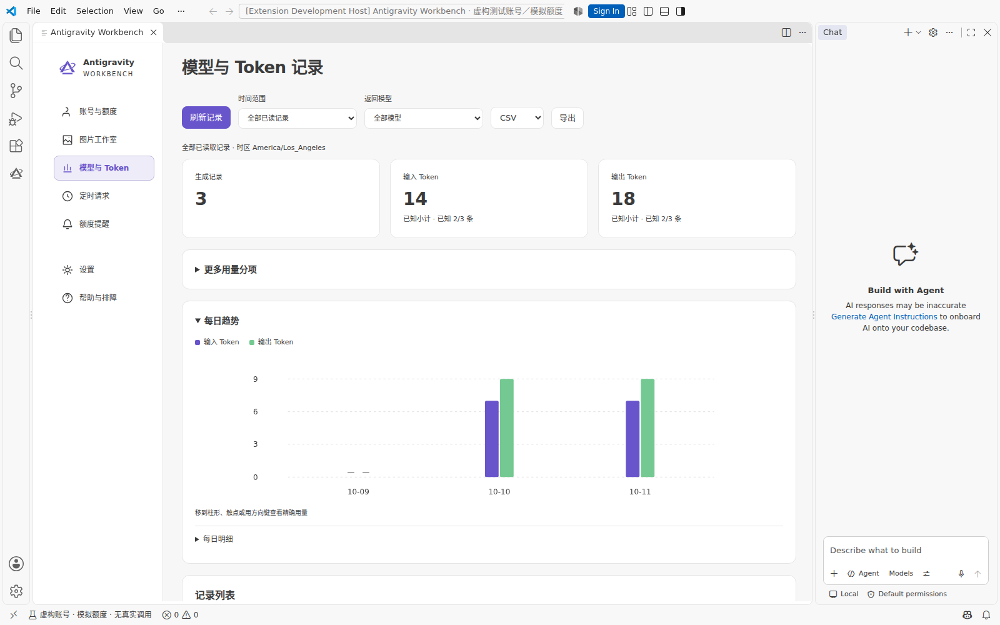

<h1 align="center">Antigravity Workbench</h1>

在 VS Code 中管理 Google Antigravity 账号、查看额度与 Token 用量并创作图片。

<strong>开源 · MIT License</strong>

简体中文 · <a href="README_EN.md">English</a>

<a href="https://github.com/XiaoXinCodes/antigravity-workbench/releases/latest">下载最新 VSIX</a> · <a href="https://marketplace.visualstudio.com/items?itemName=xiaoxincodes.antigravity-account-manager">扩展市场</a> · <a href="docs/README.md">使用文档</a> · <a href="CHANGELOG.md">更新日志</a>

账号、额度、图片、用量记录和定时功能集中在一个工作台中。点击活动栏 **A 图标**，或执行命令 **Antigravity Workbench: 在编辑器打开工作台**。宽屏保留左侧导航，窄窗口使用“切换功能”；切换页面保留草稿、选择和筛选。默认中文，可在设置中全局切换 English；外观跟随 VS Code 的深浅色与高对比度主题。

本项目独立开发，与 Google 不存在隶属、授权或背书关系。可用模型、权限与额度以所选账号的服务端结果为准。

## 安装与升级

需要 VS Code 1.95+，以及可用的 Google Antigravity 扩展和登录。Workbench 与官方扩展须运行在同一个本机或 WSL 宿主。

1. 从 [最新 GitHub Release](https://github.com/XiaoXinCodes/antigravity-workbench/releases/latest) 下载 `.vsix`。
2. 在目标窗口执行 **Extensions: Install from VSIX…**，选择文件。也可从 [扩展市场](https://marketplace.visualstudio.com/items?itemName=xiaoxincodes.antigravity-account-manager) 安装市场已上架版本。
3. 保存当前工作并按提示重载，点击活动栏 A 图标。

核对扩展 ID `xiaoxincodes.antigravity-account-manager`。WSL 用户应核对官方扩展的实际运行宿主，将两个扩展安装到同一位置。升级保留已有账号、图片、草稿和设置，无需清空登录文件。GitHub 与 Marketplace 的更新节奏可能不同，正式 VSIX、源码和校验文件以 Release 附件为准。

支持 Windows、macOS、Linux 与匹配的 WSL Linux 宿主；其他远程环境见 [兼容性](docs/COMPATIBILITY.md)。

## 功能与使用

### 账号与额度

通过浏览器 OAuth 添加账号，或核验并保存当前官方登录。在账号卡片切换、刷新或移除；切换确认会列出可能被中断的后台与任务范围。移除当前账号时先尝试安全切换可用替代账号，失败则保留原副本。

搜索账号，比较同一模型的剩余比例，按额度、更新时间或重置时间排序；批量刷新可取消。收藏模型、折叠家族分组、用 QuickPick 查看额度或置顶状态栏。在“实时额度／额度观察历史”标签中查看和筛选历史。未知额度保持未知，旧结果保留查询时间，百分比不换算图片张数。

“导入、导出与恢复”按需展开。账号迁移使用加密 `.agwenc`，同邮箱可覆盖或跳过；导入不改变当前官方登录。详见 [账号管理](docs/INDEPENDENT_ACCOUNTS.md)、[加密迁移](docs/ACCOUNT_MIGRATION.md) 和 [额度工作流](docs/QUOTA_WORKFLOWS.md)。

### 图片工作室

跟随当前登录或独立选择已保存账号，加载该账号的图片模型并查询所选模型额度；独立选择不会切换官方登录。填写提示词，添加最多 3 张 PNG/JPEG 参考图，选择比例、尺寸、细节与 1–4 次请求。确认账号、模型、次数和保存目录后才发送。

草稿与历史任务自动保存。复用历史参数、从结果继续修改、比较版本，或预览、复制路径／Markdown、插入编辑器和复制图片到项目；保留原图，不覆盖目标文件。缺失参考图有提示，中断任务不会自动重发。详见 [图片生成](docs/IMAGE_GENERATION.md) 和 [用进项目](docs/IMAGE_RESULTS.md)。

### 模型与 Token

首次打开自动只读加载本机记录，概览和列表在同一页。返回页面复用已有结果；点击刷新更新。未发现来源时才显示选择入口。按时间、返回模型与项目筛选，查看每日趋势或单条详情，导出 CSV／JSON；空时段可“查看全部”。趋势支持悬停、点按和方向键查看精确日期与用量。

缺失 Token 或型号显示“未提供”，不算成零；返回型号不证明底层实际模型。读取与导出不会发送模型请求。详见 [记录与用量](docs/REQUEST_MODEL_OBSERVATIONS.md)。

### 定时请求与额度提醒

从主导航分别打开“定时请求”和“额度提醒”。提醒和定时总开关默认关闭，新保存的任务也不启用。提醒支持低额度、耗尽和恢复；提醒本身不发送模型请求。

定时请求自动读取所选账号的普通模型目录。初始化或正常操作占用期间显示准备状态，就绪后自动继续；刷新显示数量、空结果或真实失败，取消保留已有列表。账号、端点和用途隔离，类型未标明的普通模型需确认用途。

| 操作 | 结果 |
| --- | --- |
| 保存，暂不启用 | 只保存设置，不执行 |
| 查看执行时间／查看检查时间 | 计算接下来 5 个时间，不保存、不执行 |
| 启用总开关及该任务 | 按日／周、间隔、五字段 cron 或满额恢复规则运行 |
| 立即执行一次 | 发送一次真实请求，不开启定时运行 |

任务发送固定短输入 `Hi`，可能消耗额度；宿主须保持运行，延误超过 5 分钟的计划会跳过。支持编辑、暂停、取消和结果查看。详见 [提醒与定时请求](docs/QUOTA_WORKFLOWS.md#提醒与定时请求)。

### 设置与帮助

在“设置”选择全局语言、账号名称与邮箱隐藏选项，以及 VS Code 主题。隐藏身份适合截图或共享屏幕，不改变账号和登录。命令面板及静态标题仍遵循 VS Code 显示语言。

“帮助与排障”连接使用指南与高级排障。技术字段、目录详情和调试日志按需展开；需要日志时先预览再导出，不自动上传。更多入口见 [设置与命令](docs/COMMANDS.md) 和 [故障排查](docs/TROUBLESHOOTING.md)。

以上截图来自实际 VS Code 界面，全部使用虚构账号、example.test 邮箱与合成用量，未使用真实账号或发送生成请求。

## 常见问题

| 问题 | 说明 |
| --- | --- |
| WSL 找不到账号或切换不可用？ | 先核对两个扩展的运行宿主，并按未完成操作的恢复提示处理。 |
| 首次模型目录正在准备？ | 等待初始化和正常操作完成；可取消。实际失败保留错误码，见折叠的目录详情。 |
| 模型未列出或类型未标明？ | 目录来自所选账号及端点；缺项不证明无权限，未知用途需明确确认。 |
| 重载后会自动继续生图？ | 不会。草稿和任务卡恢复，中断任务需明确重新提交。 |
| 保存或预览定时任务会执行？ | 不会。自动执行需两个开关均开启；“立即执行一次”另行发送真实请求。 |

## 隐私、文档与反馈

账号凭据存放于 VS Code SecretStorage 或宿主受限存储；账号导出采用加密格式。草稿、参考图路径和任务记录保存在当前宿主，图片写入所选目录。生成时，所选账号的授权、提示词和参考图发送至相应 Google 服务；仅提交你有权使用的内容。

[快速开始](docs/GETTING_STARTED.md) · [完整文档](docs/README.md) · [更新日志](CHANGELOG.md) · [项目与服务说明](docs/PROJECT_NOTICES.md)

在 [Issues](https://github.com/XiaoXinCodes/antigravity-workbench/issues) 提供版本、系统、宿主、复现步骤和错误码，不提交凭据或私人内容。疑似安全漏洞按 [安全报告流程](SECURITY.md) 私下报告。贡献和构建步骤见 [贡献指南](CONTRIBUTING.md)。

## 许可

项目自有源码采用 [MIT License](LICENSE)，允许使用、修改、分发和商业使用，请保留版权和许可声明。第三方代码保留各自许可，见 [第三方声明](THIRD_PARTY_NOTICES.txt)；已发布版本以对应发行包中的许可为准。
