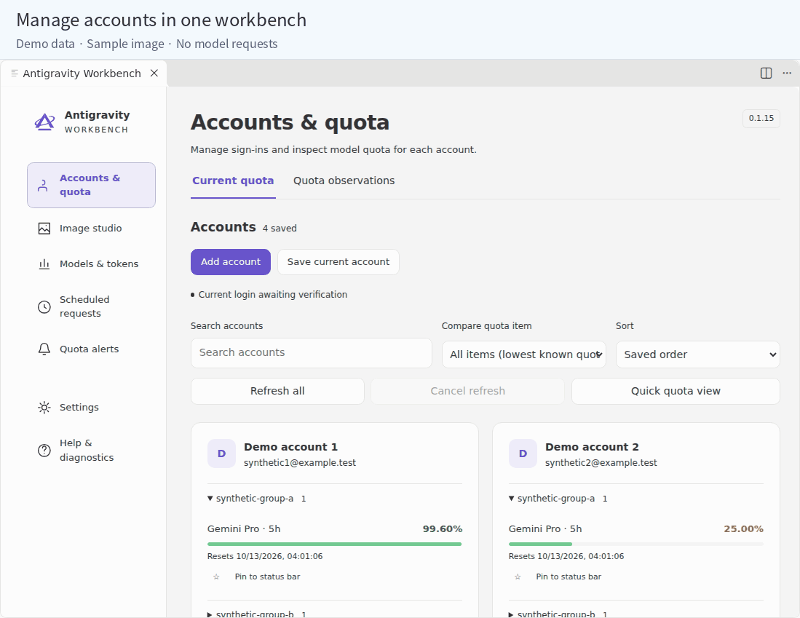

# Antigravity Workbench

**One VS Code workbench for your Antigravity accounts, image creation and Token usage.**

Spend less time moving between views: compare model quotas across accounts, choose an image account independently, pick up past image tasks and inspect local model and Token records.

**[Install from VS Code Marketplace](https://marketplace.visualstudio.com/items?itemName=xiaoxincodes.antigravity-account-manager)** · **[Install from Open VSX](https://open-vsx.org/extension/xiaoxincodes/antigravity-account-manager)** · [Quick start](#quick-start) · [Documentation](docs/README.md) · [简体中文](README.md)

*Actual VS Code UI with fictional accounts, synthetic quota and usage, and a repository sample image. No model requests were sent. The demo shows image task reuse, not online generation.*

## Three things in one workbench

### Multiple accounts: check quota before choosing

Add accounts through browser sign-in or save your current login. Switch, refresh and manage accounts on their cards. Compare the same model's remaining quota and reset time, search and sort accounts, or favorite frequently used models. Move saved accounts between devices with encrypted import and export.

Switching shows the current step beside the selected account. Account commit and backend recovery are reported separately. The normal route requires no recovery password, external terminal or closing all windows. Optional host restart recovery requires confirmation and can affect other extensions in that window.

[Accounts and switching](docs/GETTING_STARTED.en.md#accounts) · [Encrypted migration](docs/ACCOUNT_MIGRATION.md) · [Quota workflows](docs/QUOTA_WORKFLOWS.md)

### Image Studio: from a prompt to a project asset

Follow the current login or choose a saved account independently for images. Enter a prompt, add references and choose ratio and size; drafts and task history are retained automatically. Reuse parameters, continue editing results, compare versions, then bring images or Markdown into your project. Choosing an image account does not switch the official login.

[Image generation and options](docs/IMAGE_GENERATION.md) · [History, iteration and project actions](docs/IMAGE_RESULTS.md)

### Model and Token records: see where usage goes

Read local records without changing the source. Filter by time, returned model and project, inspect daily trends and export CSV / JSON. Missing usage stays “Not provided” instead of zero. Viewing and exporting send no model requests.

[Records and usage](docs/REQUEST_MODEL_OBSERVATIONS.md)

**Need alerts or scheduled actions?** Enable low-quota, exhaustion and recovery alerts, or schedule ordinary model requests by calendar, interval or quota recovery. Alerts and schedules default to off. Scheduled requests may consume quota and require the host to stay running. [Settings and execution rules](docs/QUOTA_WORKFLOWS.md)

## Quick start

You need **VS Code 1.95+**, a working **Google Antigravity extension and login**, and both extensions running on the same host.

1. Install from [Marketplace](https://marketplace.visualstudio.com/items?itemName=xiaoxincodes.antigravity-account-manager) or [Open VSX](https://open-vsx.org/extension/xiaoxincodes/antigravity-account-manager), or search for **Antigravity Workbench** in VS Code's Extensions view and install it. Verify publisher **XiaoXinCodes** and extension ID `xiaoxincodes.antigravity-account-manager`.
2. Reload when prompted, then click **A** in the Activity Bar to open the workbench. Select **English** in Settings if needed; Simplified Chinese is the default.
3. In **Accounts & quota**, check the verified current identity. Use **Save current account** or **Add account** when needed, then refresh quota.
4. Open **Image Studio** to choose an account and model for creation, or **Model and Token records** to inspect local usage.

Save your work before switching accounts and review the background processes and tasks listed in the confirmation. Switching may interrupt active tasks in that scope. Adding and switching accounts are separate actions. See the [full guide](docs/GETTING_STARTED.en.md).

**WSL:** Check where Google Antigravity actually runs. If it runs in WSL, install Workbench in that same distribution; if it runs locally, keep both extensions local. [Host setup](docs/ENVIRONMENTS.md)

**Offline installation:** Download the `.vsix` from the [latest Release](https://github.com/XiaoXinCodes/antigravity-workbench/releases/latest) and run **Extensions: Install from VSIX…** in the target window. Upgrades do not require clearing accounts, login files, sessions or images.

## Compatibility and privacy

- Supports local Windows, macOS and Linux extension hosts and WSL Linux workspace hosts. SSH, containers and the **standalone Antigravity IDE remain unverified**. [Compatibility and limits](docs/COMPATIBILITY.md)
- Available models, permissions, output and quota depend on the selected account's server response. Quota percentages are not image counts. This independent project is not affiliated with, authorized by or endorsed by Google.
- Credentials use VS Code SecretStorage or restricted host storage; account exports are encrypted. Drafts, reference paths and task records stay on the current host; images save to your chosen folder. Generation sends authorization, prompts and references to the corresponding Google service. Submit only content you have the right to use. [Data and security](docs/PROJECT_NOTICES.md)

## Documentation and feedback

[All documentation](docs/README.md) · [Troubleshooting](docs/TROUBLESHOOTING.md) · [Changelog](CHANGELOG_EN.md) · [Contributing](CONTRIBUTING.md)

Some detailed guides are currently in Chinese. Report version, OS, host, reproduction steps and error code in [Issues](https://github.com/XiaoXinCodes/antigravity-workbench/issues), without credentials or private content. Follow [Security](SECURITY.md) for vulnerability reports.

If Workbench saves you a few trips between windows, a **Star** helps others discover it and makes it easy to find again.

Project-owned code uses the [MIT License](LICENSE), allowing use, modification, distribution and commercial use with the required notices. See [third-party notices](THIRD_PARTY_NOTICES.txt) for other materials.
