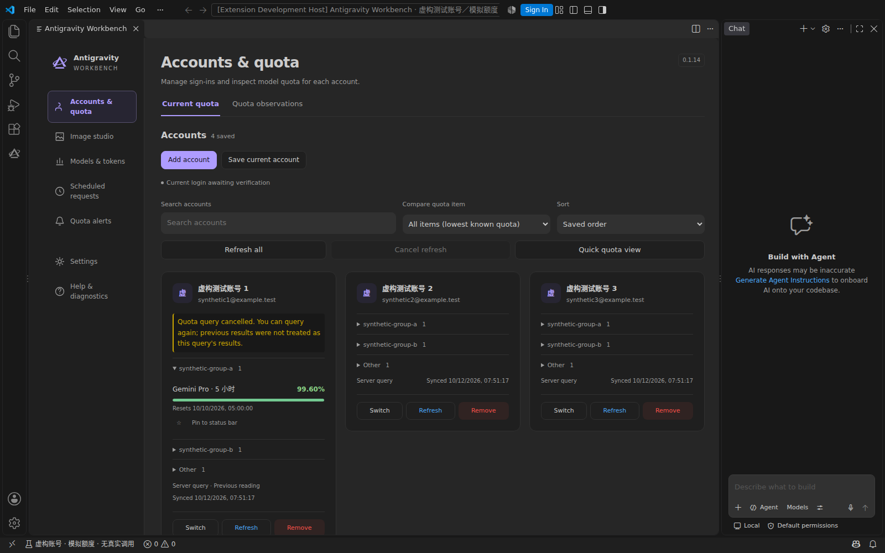
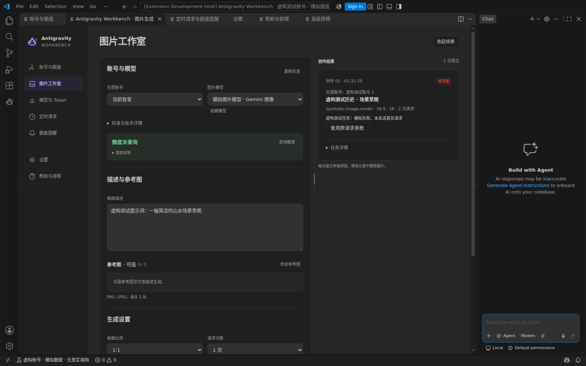
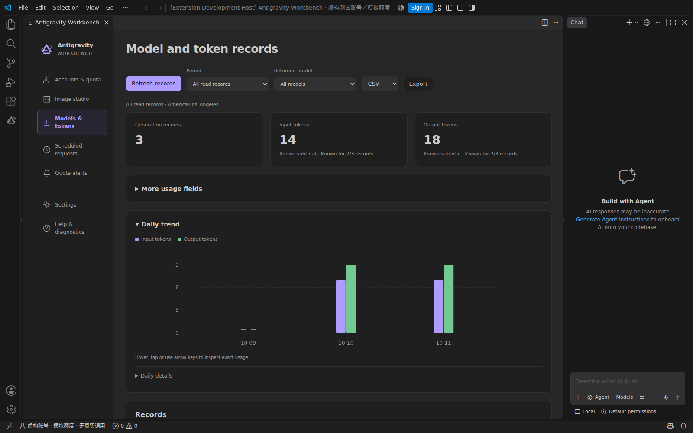
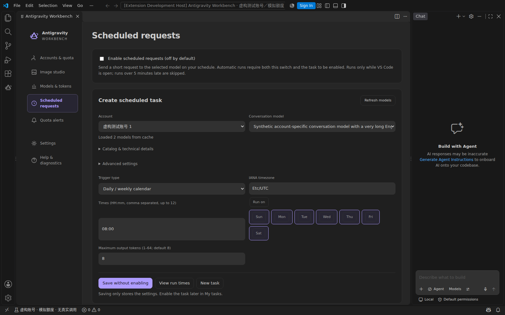

<h1 align="center">Antigravity Workbench</h1>

Google Antigravity multi-account management, Gemini quota, encrypted migration and Image Studio in one VS Code workbench.

<strong>Open source · MIT License</strong>

<a href="README.md">简体中文</a> · English

<a href="https://github.com/XiaoXinCodes/antigravity-workbench/releases/latest">Download latest VSIX</a> · <a href="https://marketplace.visualstudio.com/items?itemName=xiaoxincodes.antigravity-account-manager">Marketplace</a> · <a href="docs/GETTING_STARTED.en.md">User guide</a> · <a href="CHANGELOG_EN.md">Changelog</a>

Accounts, quotas, images, usage records and scheduled tasks share one workbench. Click the **A activity icon**, or run **Antigravity Workbench: Open Workbench in Editor**. Wide views keep left navigation visible; narrow views use **Switch feature**. Changing pages retains drafts, selections and filters. Simplified Chinese is the default; choose English globally in Settings. Appearance follows VS Code's light, dark and high contrast themes.

Migrate accounts with encrypted `.agwenc` files. Image Studio can use an independently selected saved account, reference images and reusable history parameters.

This independent project is not affiliated with, authorized by or endorsed by Google. Available models, permissions and quota depend on the selected account's server responses.

## Installation and upgrades

Requires VS Code 1.95+ and an available Google Antigravity extension and login. Workbench and the official extension must run on the same local or WSL host.

1. Download the `.vsix` from the [latest GitHub Release](https://github.com/XiaoXinCodes/antigravity-workbench/releases/latest).
2. Run **Extensions: Install from VSIX…** in the target window and select the file. You can also install the version currently available on [Marketplace](https://marketplace.visualstudio.com/items?itemName=xiaoxincodes.antigravity-account-manager).
3. Save your work, reload when prompted, and click the A activity icon.

Verify extension ID `xiaoxincodes.antigravity-account-manager`. In WSL, check the official extension's actual host and install both extensions in that same location. Upgrades retain accounts, images, drafts and settings; no login-file reset is required. GitHub and Marketplace updates may arrive at different times. Release assets provide the official VSIX, source and checksums.

Supports Windows, macOS, Linux and matching WSL Linux hosts. Standalone Antigravity IDE compatibility is not yet verified; its extension registry does not establish feature compatibility with the VS Code environment above. See [compatibility](docs/COMPATIBILITY.md).

## Features and use

### Accounts and quota

Add accounts through browser OAuth, or verify and save the current official login. Switch, refresh or remove accounts on their cards. Switch confirmation lists background processes and tasks that may be interrupted. Removing the current account first attempts to switch safely to an available replacement; a failed switch retains the old copy.

Search accounts, compare the same model's remaining fraction, and sort by quota, update or reset time. Cancel batch refresh, favorite models, collapse model families, use QuickPick or pin a quota to the status bar. Current quota and Quota observations tabs provide current results and filterable history. Unknown quota stays unknown, old results retain their query time, and percentages are not converted to image counts.

Expand import, export and recovery when needed. Account migration uses encrypted `.agwenc` files; matching emails can be replaced or skipped. Import keeps the current official login unchanged. See [account management](docs/INDEPENDENT_ACCOUNTS.md), [migration](docs/ACCOUNT_MIGRATION.md) and [quota workflows](docs/QUOTA_WORKFLOWS.md).

### Image Studio

Follow the current login or select a saved account independently, load that account's image models and query the selected model's quota. Independent selection does not switch the official login. Enter a prompt, add up to 3 PNG/JPEG references, and choose ratio, size, detail and 1–4 requests. Submission requires confirmation of the account, model, count and save folder.

Drafts and task history save automatically. Reuse parameters, continue editing a result, compare versions, preview images, copy paths/Markdown, insert into the editor or copy images into a project. Originals remain intact and destination files are not overwritten. Missing references are identified; interrupted tasks are not automatically resent. See [image generation](docs/IMAGE_GENERATION.md) and [project actions](docs/IMAGE_RESULTS.md).

### Model and Token records

The first opening automatically reads local records without modifying the source. Totals and records share one page. Returning reuses loaded data; Refresh updates it. Source selection appears when discovery finds no source. Filter by time, returned model and project; inspect trends and individual records, export CSV/JSON, or use View all for empty periods. Hover, tap or use arrow keys to inspect exact daily dates and usage.

Missing tokens or model declarations remain Not provided rather than zero. Returned names do not prove underlying model identity. Reading and export send no model request. See [records and usage](docs/REQUEST_MODEL_OBSERVATIONS.md).

### Schedules and quota alerts

Open Schedules and Quota alerts separately in the main navigation. Alerts, the global schedule switch and new tasks default to off. Alerts cover low quota, exhaustion and recovery; alerts do not send model requests.

Schedules load the selected account's conversation-model directory automatically. Initialization or an ordinary operation in progress shows preparation; loading continues when ready. Refresh reports the count, an empty result or actual failure, and cancellation retains previous choices. Account, endpoint and usage stay isolated; models with unspecified usage require confirmation.

| Action | Result |
| --- | --- |
| Save without enabling | Store settings without executing |
| View run times / View check times | Compute the next 5 times without saving or executing |
| Enable both the global switch and task | Run on calendar, interval, five-field cron or full-quota recovery rules |
| Run once now | Send one real request without enabling scheduled runs |

Tasks send a fixed short input, `Hi`, and may consume quota. The host must remain running; occurrences delayed more than 5 minutes are skipped. Edit, pause, cancel and inspect results as needed. See [quota workflows](docs/QUOTA_WORKFLOWS.md).

### Settings and help

Select the global language, account-name/email hiding option and VS Code theme in Settings. Hiding identities is useful for screenshots or screen sharing and does not change accounts or login. Static Command Palette titles continue to follow VS Code's display language.

Help links to guides and advanced troubleshooting. Technical fields, directory details and diagnostic logs remain expandable. Preview logs before exporting; they are not uploaded automatically. See [settings and commands](docs/COMMANDS.md) and [troubleshooting](docs/TROUBLESHOOTING.md).

Screenshots show the actual VS Code interface with fictional accounts, example.test emails and synthetic usage. No real accounts or generation requests were used.

## FAQ

| Question | Answer |
| --- | --- |
| Accounts missing in WSL or switching unavailable? | Check both extension hosts and follow recovery guidance for incomplete operations. |
| The first model directory is preparing? | Wait for initialization and ordinary operations to finish, or cancel. Actual failures retain a code in expandable directory details. |
| A model is absent or its usage is unspecified? | The directory belongs to the selected account and endpoint; absence does not prove lack of permission. Unspecified usage requires confirmation. |
| Will images resume automatically after reload? | No. Drafts and task cards restore; interrupted tasks require explicit resubmission. |
| Will saving or previewing a task execute it? | No. Automatic runs require both switches; Run once now explicitly sends a separate real request. |

## Privacy, documentation and feedback

Credentials use VS Code SecretStorage or restricted host storage. Account exports are encrypted. Drafts, reference paths and task records remain on the current host; images save to the chosen folder. Generation sends the selected authorization, prompt and references to the corresponding Google service. Submit only content you have the right to use.

[Getting started](docs/GETTING_STARTED.en.md) · [Documentation](docs/README.md) · [Changelog](CHANGELOG_EN.md) · [Project and service notices](docs/PROJECT_NOTICES.md)

Report version, OS, host, reproduction steps and error code in [Issues](https://github.com/XiaoXinCodes/antigravity-workbench/issues); do not include credentials or private content. Follow [Security](SECURITY.md) for private vulnerability reports. See [Contributing](CONTRIBUTING.md) for build and contribution steps.

## License

Project-owned source uses the [MIT License](LICENSE), allowing use, modification, distribution and commercial use while retaining copyright and license notices. Third-party code retains its own licenses; see [third-party notices](THIRD_PARTY_NOTICES.txt). Published versions use the licenses shipped in their own packages.
