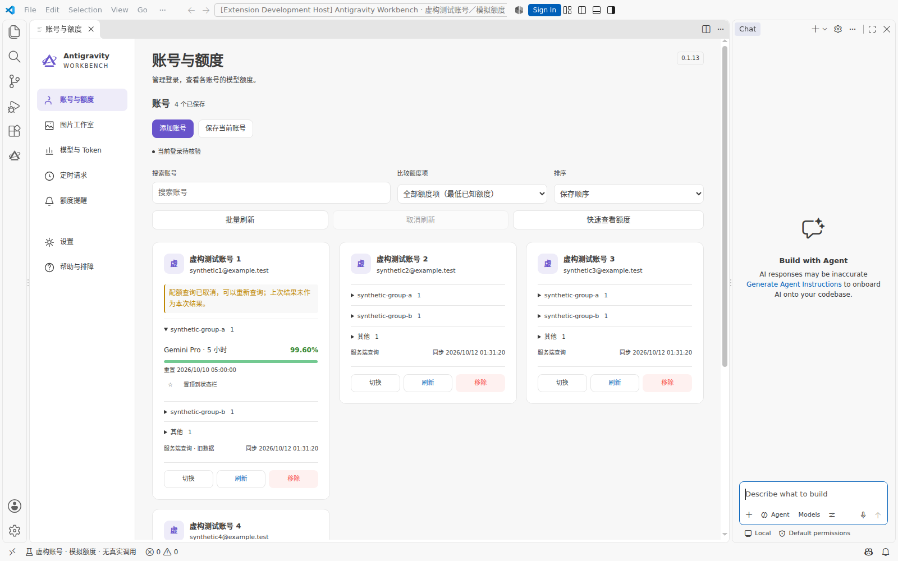
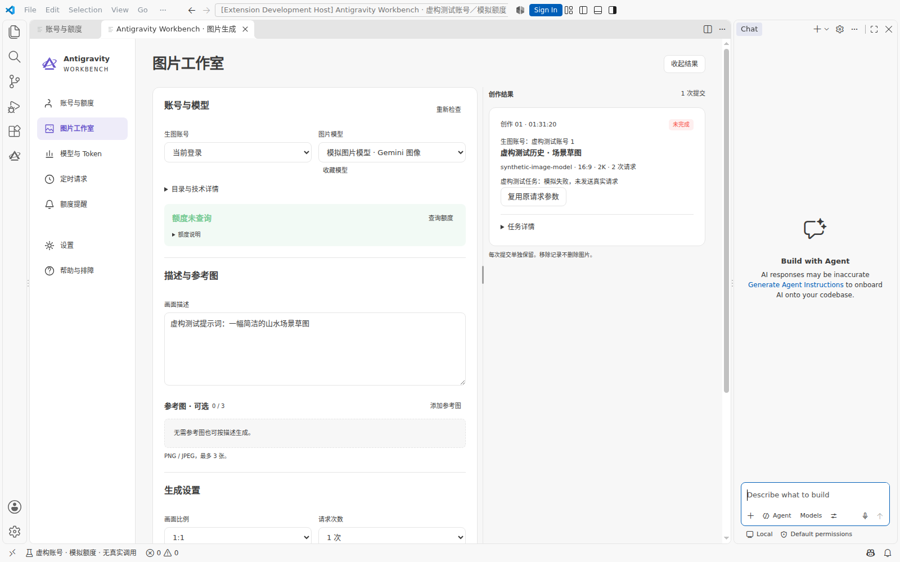
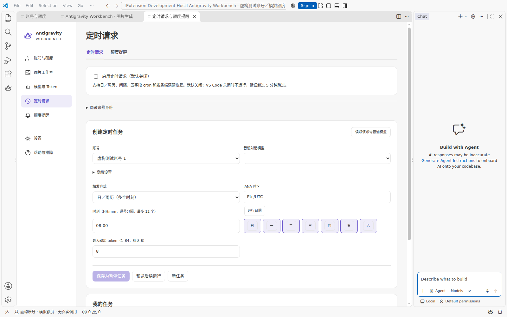
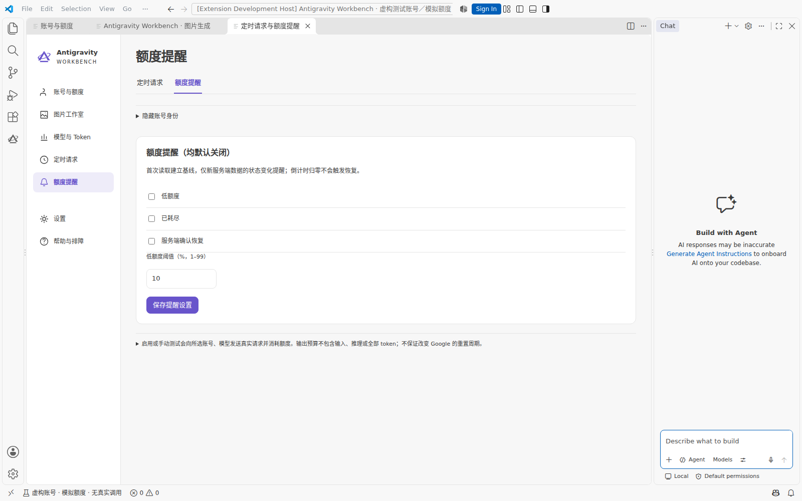
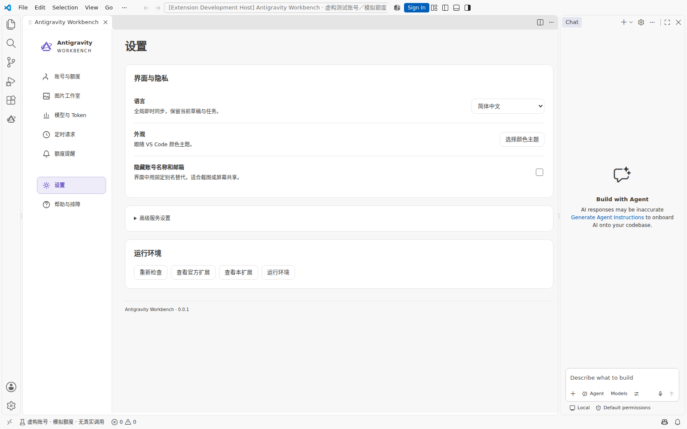
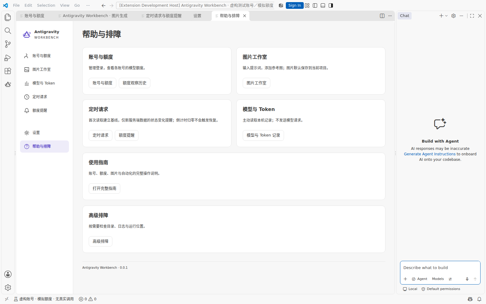
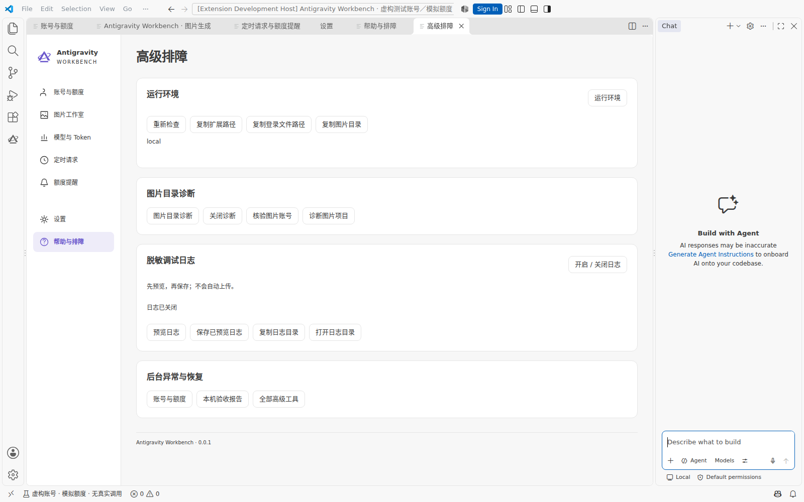
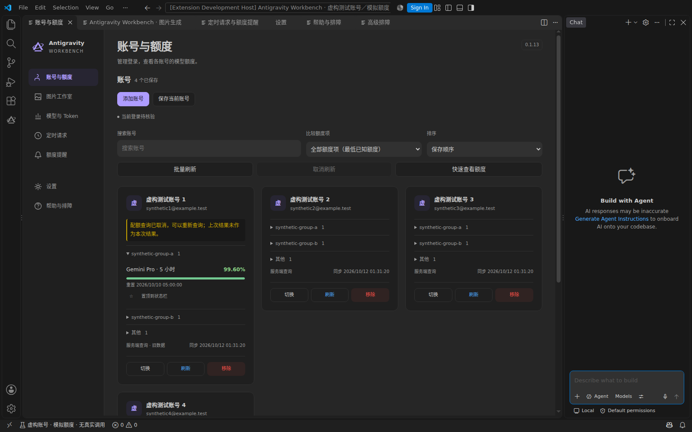
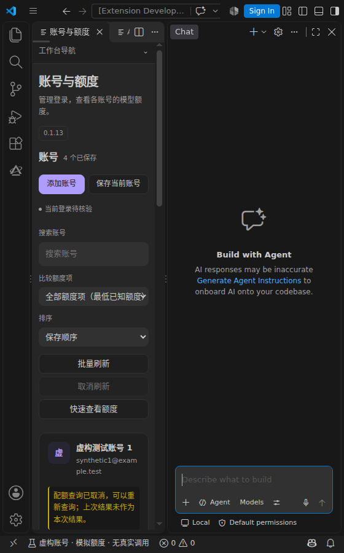
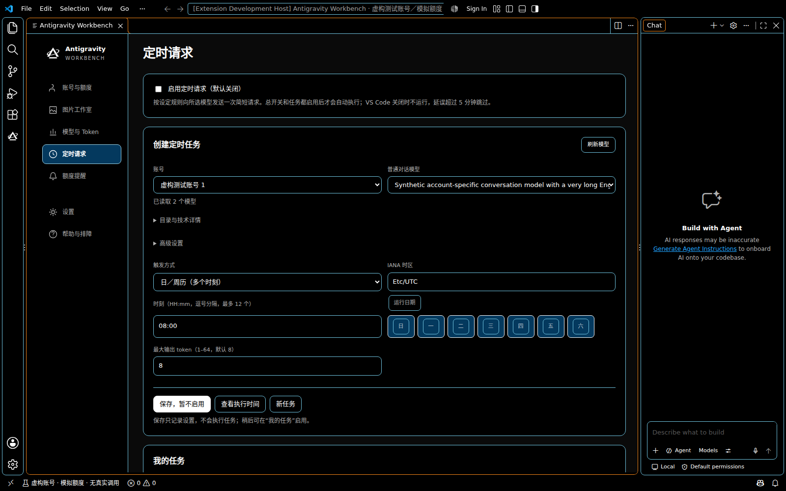

# 全产品设计实施与验收

基线：main `344eb1a67a89d9845e91eaebc81e159f9d537ab0`（0.1.13）。实施分支：`codex/unified-workbench-design`。依据用户确认的 `Antigravity-Workbench-Design-Preview.html` 与 `DESIGN-REVIEW.md`。

## 实现顺序

1. 共享 UI：主题令牌、间距/字体/边框、主次危险按钮、图标、导航、键盘焦点与窄屏行为。
2. 账号与额度：紧凑侧栏与编辑器工作台、搜索/比较/排序、账号操作/迁移/恢复、收藏/置顶、额度历史。
3. 图片：统一创作设置与结果、参考图、参数、草稿、任务、版本与项目操作；保持既有请求与保存门禁。
4. 记录与调度：记录筛选/覆盖/趋势/导出、四类计划/预览/暂停/取消、额度提醒；状态刷新不重建用户输入。
5. 设置/帮助/排障：全局语言入口、主题跟随 VS Code、隐私、端点、使用指南、运行位置/目录/日志与恢复。
6. 实际验收：单测与完整 checks、真实隔离 VS Code UI（合成适配器）、深浅/高对比、窄宽屏、重开/取消/异步迟到与语言同步。

## 必须保持

- 真实账号与模型数据来自现有控制器，不引入预览示例账号、额度、任务、图片或演示按钮。
- OAuth、切换、移除、加密迁移及费用确认继续使用既有受验证流程。
- 不恢复图片跨账号额度比较、自动换号/重发或 Codex 协作。
- 未知/旧数据保持语义；重开不触发未经请求的发送、登录或诊断。
- 全局设置只写用户级配置，语言同步不丢失草稿、筛选、任务编辑或焦点。
- 真实 UI 测试在隔离配置与扩展目录运行，不安装到用户现有扩展目录，不使用真实凭证。

## 交付门槛

相关测试和完整 `npm run check` 通过；实际 UI 回归与人工像素检查有收据；最终文档截图采用生产界面；提交与专用分支推送到 GitHub；候选 VSIX 仅交审核，不安装、合并或发布。

## 实现阶段记录

共享主题与导航、账号编辑器、图片/额度历史/记录/调度展示、全局设置/帮助/排障均已接入生产控制器。完整 check：1654 项，1650 通过、4 个平台用例跳过；类型检查、lint、模型硬编码检查通过。记录宿主专项回归通过；新的全产品宿主回归验证深浅/高对比、窄屏、重复打开、刷新取消、四种模式、全局语言与草稿保留。所有宿主测试使用隔离配置和合成适配器，真实模型发送为 0。原有额度、历史、自动化、高级触发、全局语言、扩展启动专项回归均已通过。本分支是候选审核版本，未安装、合并或发布。

## 生产界面

以下为真实 VS Code 1.141.0 宿主中的生产 UI，数据为合成适配器，真实请求为 0。全产品截图收据及专项回归结果摘要见 [验收记录](unified-design-validation.json)。

### 账号与额度

### 图片工作室

### 计划

### 额度提醒

### 设置

### 帮助

### 排障

### 深色主题

### 窄窗口

### 高对比度

## 导航与本机记录交互修正

活动栏默认进入同一个完整编辑器，宽屏常驻左侧导航，窄屏用明确的切换功能按钮。各模块保留原有独立控制器与取消边界，共享宿主缓存访问过的页面；返回保留草稿与筛选。记录首次打开自动只读发现，重复打开去重，关闭取消，旧结果不能覆盖新页面。每日趋势提供精确日期和输入/输出用量，支持实际鼠标悬停、键盘与触屏 PointerEvent。未知值仍显示未知。

更新回归：9 页宽窄与深浅/高对比、单编辑器、草稿/筛选缓存、自动读取和精确趋势；完整 check 1658 项，1654 通过、4 个平台跳过、0 失败。新增真实 UI 用例加入 Linux CI，Windows/macOS 保持原有宿主及包校验。下方较早截图保留为初版设计对照；最新合成截图与收据由 test:design-host 生成。

## 验收入口收敛

账号页移除旧“更多操作”跨模块卡片及页脚设置、帮助快捷入口；定时请求页移除与主导航重复的标签和身份开关，帮助页移除跨模块跳转按钮。独有的额度观察历史归入账号与额度页“实时额度／额度观察历史”页内标签，功能及保留数据不变。全局身份显示开关只位于设置，名称为“隐藏账号名称和邮箱”，说明其截图、屏幕共享用途，默认值和显示脱敏范围不变。

## 模型目录自动加载与共享

定时请求首次填入账号后自动加载目录，读取状态与模型下拉相邻；刷新、取消、完成数量、空列表和失败保留旧列表均有页面内反馈。现有账号目录服务按账号、身份、凭据版本、项目和端点统一存取公共目录，生图与普通对话按已有解释器筛选用途。过期数据后台更新，并发请求合并；单个订阅取消不影响其他订阅，全部取消阻断迟到缓存写入。凭据事件按账号撤销目录与选择证明，端点及身份变化不会串用旧结果。缓存不替代发送前重新核验，不做生成探测，模型与 Token 本地记录逻辑未改变。

### 首次定时目录读取（2026-10-12）

首次打开会等待账号初始化、Hub 身份检查和正常操作占用结束，再自动读取模型目录。等待最多 30 秒，可取消；不清理锁、不终止进程、不调用生成接口。仅对已确认活跃的普通操作锁等待，恢复锁、不明锁、其他配置文件以及身份/HTTP/解析失败保留真实错误。折叠详情显示固定错误码、阶段、类别及可用的 HTTP 状态，不保留异常正文、邮箱或凭据。

合成测试复现了首次 `LIVE_OPERATION_OR_RECOVERY_LOCKED`（lock 阶段）、锁释放后手动成功的时序。用户截图只有统一失败文案，现场错误码未记录，因此不能认定现场与合成复现为同一原因。实际隔离 VS Code 页面验证了冷启动等待、就绪后自动加载、重新打开、取消不重启，以及等待期间账号/端点切换只接受最新范围。离线回归 1,678 通过、4 项平台跳过；新增 15 项针对初始化及锁竞争。用户正在运行的真实窗口需要自行保存工作后重新加载，未强制重载。
